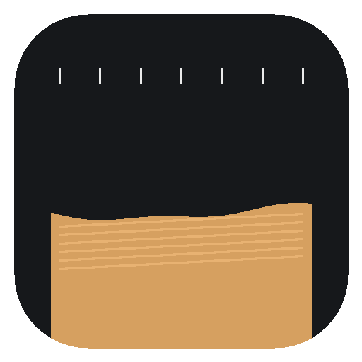

# dsh-disk-lens

右侧边栏里的磁盘面板。规则先量一遍磁盘，模型再补充判断；面板只负责显示，扫描、分析、清理都在主对话里完成。



## 它在做什么

- **只读面板**：右栏的一个标签页，显示容量分段条、分类列表和清理建议。面板里没有按钮、没有勾选框、没有输入框。
- **扫描**：14 条规则覆盖缓存、构建产物、包管理器、AI 模型、容器、浏览器、创意软件、游戏、废纸篓等位置，用 `du -akx` 测量，可并行、可超时。
- **建议**：规则自带一批清理候选，模型还能再补；每条都有 safety 等级、执行方式与完整命令。
- **执行**：所有动作由主对话里的模型调用工具完成，默认进废纸篓；`delete` 需要在设置里显式打开开关。
- **审计**：每次扫描、建议写入、清理都追加到 `audit.jsonl`。

## 怎么打开

右侧栏的「开始」页（空态）里有一张「盘面」入口卡，点一下就在右栏打开。关掉之后还能从同一张卡再开回来。

## 操作在主对话里

面板本身没有任何写入口。要对磁盘做点什么，在正常对话里说：

- 「扫描一下磁盘」→ `disk_scan`
- 「现在盘上什么最大」→ `disk_state`
- 「把这几条建议清掉」→ `disk_clean`

面板会自己轮询刷新，显示扫描进度和最新结果。

## 与 Kanso 的差别

| | Kanso 0.1.11 | dsh-disk-lens |
|---|---|---|
| 大脑 | 外部 CLI（Claude Code / Codex / Pi） | 主对话的模型，调用 `disk_*` 工具 |
| 入口 | 独立应用窗口 | DSH Web GUI 右侧边栏里的一个标签 |
| 规则 | 编在 bundle 里 | `src/host/rules.js`，改完刷新即生效 |
| 执行 | 点确认直接跑 | 模型调用 `disk_clean`，默认废纸篓 |
| 状态 | Application Support 私有目录 | `~/.dsh/storages/dsh-disk-lens/`，纯 JSON |

## 规则

规则表是普通数组，每条包含 `id`、`family`、`name`、`items`、可选的 `cleanup` 生成器。加一条自己的规则：

```js
{
  id: 'my-rule',
  family: 'caches',       // content | tools | caches | system
  name: '我的缓存目录',
  items: [{ label: '某个目录', path: '~/some/cache' }],
  cleanup: (measured) => [{
    id: 'my-rule:clear',
    label: '清掉它',
    why: '可以重新生成。',
    bytes: measured.get('~/some/cache') ?? 0,
    safety: 'safe',
    method: 'trash',
    paths: ['~/some/cache'],
  }],
}
```

## 工具（给主对话的模型）

- `disk_scan`：跑一次扫描并返回摘要。
- `disk_state`：读上次快照，不测量。
- `disk_propose`：提交分类与清理建议。
- `disk_clean`：执行选中的建议。

## 安全

- 受保护目录不许整目录删除，系统目录、`~/.ssh`、`~/.gnupg`、钥匙串、邮件、信息、iCloud 文档一律拒绝。
- 家目录之外只允许 `/Applications` 与 `/Library/Caches`。
- 命令黑名单挡住 `sudo`、`rm -rf /`、`mkfs`、`diskutil erase`、fork bomb、`dd if=`、写 `/dev/disk*`。
- 每条建议带审查签名（method + paths + command 的 sha256 前缀），执行前重算，改动过就拒绝。
- 默认 `trash`；`delete` 必须在 `settings.json` 里打开 `allowDelete`。

## 数据

```
~/.dsh/storages/dsh-disk-lens/
├── snapshot.json   最后一次扫描
├── settings.json   删除开关、并发数、被关掉的规则
├── plan.json       最后一次生成的清理计划与脚本
└── audit.jsonl     审计日志
```

## 安装

```sh
dsh plugin install /绝对路径/plugins/dsh-disk-lens
```

或在 DSH 的插件管理里安装本地 bundle。改了宿主半边或浏览器半边都要重启 DSH 才生效。

## 许可

MIT。
